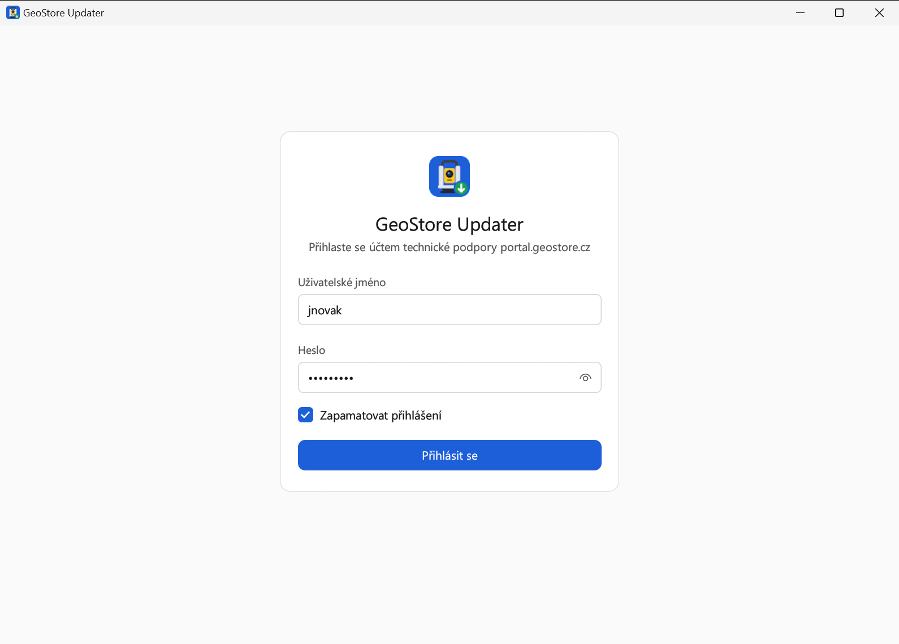
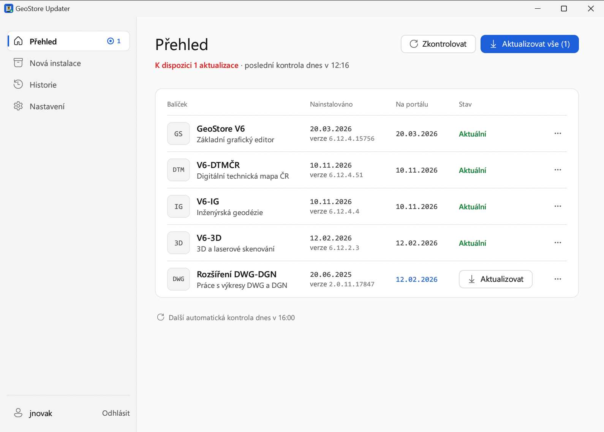
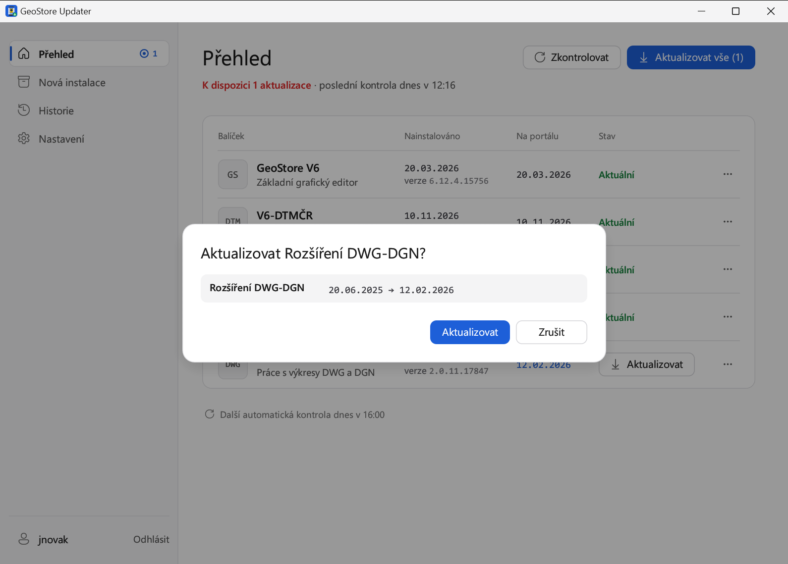
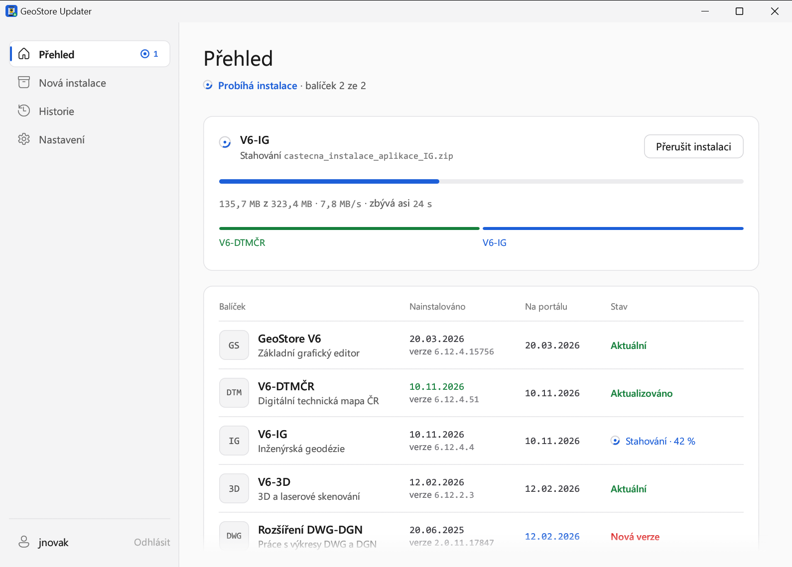
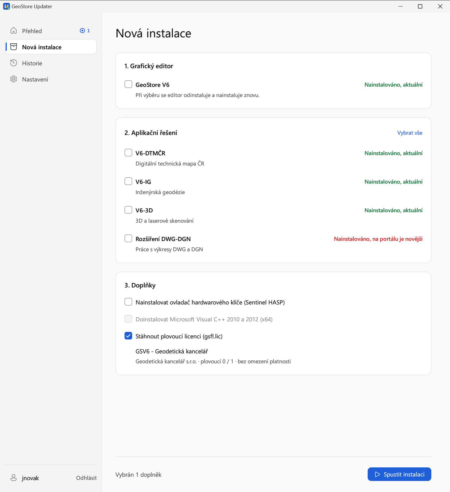
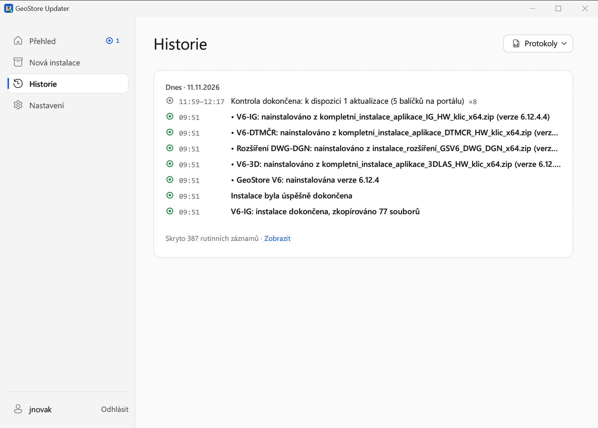
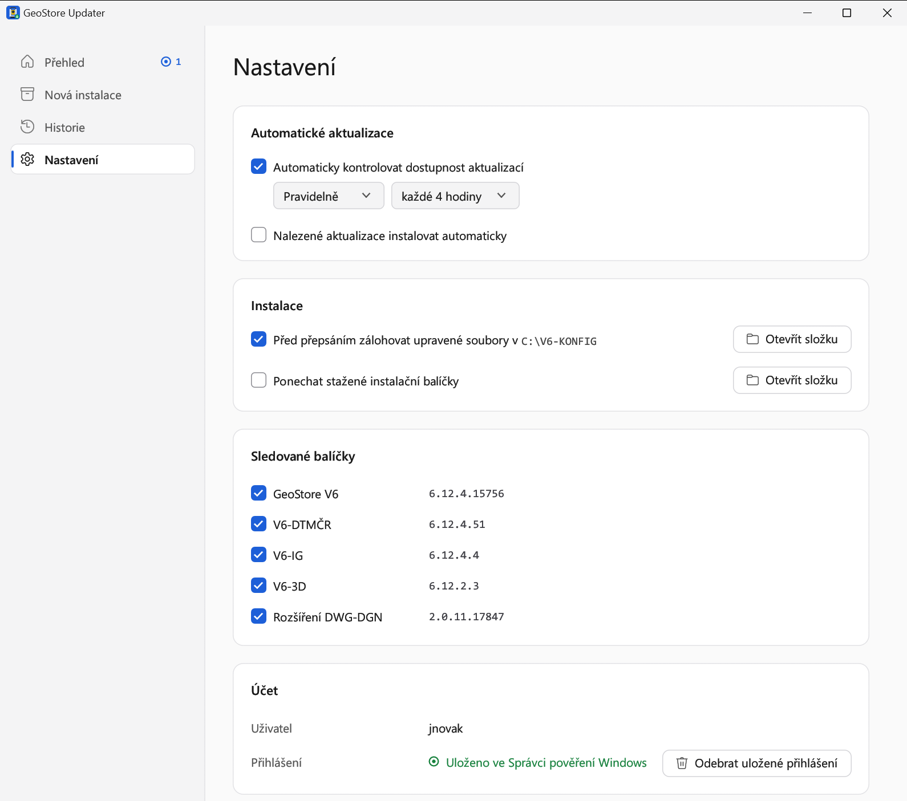

# GeoStore Updater

GeoStore Updater hlídá a instaluje aktualizace programu **GeoStore V6** a jeho aplikačních řešení (V6-DTMČR, V6-IG, V6-3D, Rozšíření DWG-DGN a další) přímo z portálu technické podpory [portal.geostore.cz](https://portal.geostore.cz).

Místo ručního stahování balíčků z portálu stačí:

- jednou se přihlásit,
- nechat aplikaci běžet na pozadí,
- a když vyjde nová verze, kliknout na **Aktualizovat** – nebo nechat aplikaci, ať aktualizace nainstaluje sama.

## Obsah

1. [Požadavky](#požadavky)
2. [Instalace](#instalace)
3. [První spuštění a přihlášení](#první-spuštění-a-přihlášení)
4. [Přehled balíčků](#přehled-balíčků)
5. [Instalace aktualizací](#instalace-aktualizací)
6. [Nová instalace](#nová-instalace)
7. [Historie](#historie)
8. [Nastavení](#nastavení)
9. [Běh na pozadí a oznámení](#běh-na-pozadí-a-oznámení)
10. [Aktualizace samotné aplikace](#aktualizace-samotné-aplikace)
11. [Kde aplikace ukládá data](#kde-aplikace-ukládá-data)
12. [Odinstalace](#odinstalace)
13. [Řešení problémů](#řešení-problémů)

## Požadavky

- Windows 10 nebo Windows 11 (64bitový)
- účet technické podpory na [portal.geostore.cz](https://portal.geostore.cz)
- práva správce počítače (instalace GeoStore V6 zapisuje do `C:\Program Files`)
- připojení k internetu

## Instalace

Aplikace je jediný soubor `GeoStoreUpdater.exe`, nic dalšího se neinstaluje.

1. Otevřete stránku [nejnovějšího vydání na GitHubu](https://github.com/Menal226/GeoStoreV6-Updater/releases/latest).
2. V části **Assets** klikněte na **`GeoStoreUpdater.exe`** a soubor uložte.
3. Přesuňte soubor do složky, kde bude trvale, například `C:\Program Files\GeoStore Updater\`.
   > Aplikace se spouští automaticky při přihlášení do Windows z místa, kde leží. Pokud ji později přesunete, spusťte ji z nového místa jednou ručně, aby se automatické spouštění přenastavilo.
4. Spusťte `GeoStoreUpdater.exe` dvojklikem.
5. Windows se zeptá na oprávnění správce (okno **Řízení uživatelských účtů**). Potvrďte **Ano**.

**Upozornění SmartScreen:** Při prvním spuštění může Windows zobrazit okno „Systém Windows ochránil váš počítač“. Aplikace není digitálně podepsaná, proto ji Windows nezná. Klikněte na **Další informace** a potom na **Přesto spustit**.

Pro pohodlné spouštění si můžete na soubor vytvořit zástupce na ploše nebo jej připnout na hlavní panel.

## První spuštění a přihlášení

1. Zadejte **uživatelské jméno** a **heslo** k účtu technické podpory portal.geostore.cz – stejné, jaké používáte na webu portálu.
2. Nechte zaškrtnuté **Zapamatovat přihlášení**. Heslo se bezpečně uloží do Správce pověření systému Windows. Bez uloženého přihlášení nefunguje automatická kontrola na pozadí.
3. Klikněte na **Přihlásit se**.

Po přihlášení aplikace načte seznam balíčků z portálu a porovná je s tím, co máte nainstalované v počítači. Při dalších spuštěních se přihlásí sama.

## Přehled balíčků

Stránka **Přehled** ukazuje všechny sledované balíčky. Pro každý balíček vidíte:

| Sloupec | Význam |
|---|---|
| **Nainstalováno** | datum vydání nainstalované verze a číslo verze v počítači |
| **Na portálu** | datum nejnovějšího balíčku na portálu (modře, pokud je novější než nainstalovaný) |
| **Stav** | **Aktuální**, **Nová verze** nebo **Nenainstalováno** |

- Počet dostupných aktualizací je také u položky **Přehled** v levém menu.
- Tlačítko **Zkontrolovat** ihned zkontroluje portál.
- Pod seznamem je čas **další automatické kontroly**.
- Balíčky, které máte na portálu k dispozici, ale nesledujete je, jsou níže v části **Další balíčky dostupné pro váš účet**. Tlačítkem **Nainstalovat** je můžete doinstalovat.

**Nabídka „⋯“** na konci každého řádku nabízí:

- **Přeinstalovat** – znovu nainstaluje aktuální verzi balíčku.
- **Označit jako aktuální** – pokud jste balíček aktualizovali jinak (ručně), aplikace jej přestane hlásit jako zastaralý.
- **Přestat sledovat** / **Sledovat aktualizace** – určuje, zda aplikace u balíčku hlídá aktualizace.

> **Poznámka:** Dokud aplikace balíček sama nenainstaluje, odhaduje jeho stav podle data souborů v počítači. Po první instalaci přes GeoStore Updater je stav přesný.

## Instalace aktualizací

1. Klikněte na **Aktualizovat vše** v pravém horním rohu, nebo na **Aktualizovat** u jednoho balíčku.
2. Aplikace ukáže, co se změní (datum nainstalované verze → datum nové verze). Potvrďte **Aktualizovat**.

3. Aplikace balíčky postupně stáhne a nainstaluje. Průběh vidíte nahoře na stránce Přehled:

**Během instalace:**

- **GeoStore V6 musí být zavřený.** Pokud je spuštěný, instalace počká a sama pokračuje, jakmile jej zavřete.
- Tlačítkem **Přerušit instalaci** instalaci zastavíte. Některé kroky (například kopírování souborů) přerušit nelze – tehdy se místo tlačítka zobrazí „Tento krok nelze přerušit“.
- Upravené konfigurační soubory v `C:\V6-KONFIG` se před přepsáním zálohují do `C:\V6-KONFIG_zalohy`.
- Po aktualizaci editoru GeoStore V6 aplikace automaticky znovu nainstaluje sledovaná aplikační řešení, aby jejich knihovny zůstaly v pořádku.

Po dokončení se zobrazí výsledek se seznamem nainstalovaných balíčků.

## Nová instalace

Stránka **Nová instalace** slouží k instalaci GeoStore V6 na nový počítač nebo k úplné přeinstalaci vybraných částí.

1. **Grafický editor** – GeoStore V6. Pokud je již nainstalovaný, při výběru se odinstaluje a nainstaluje znovu.
2. **Aplikační řešení** – vyberte řešení, která chcete nainstalovat (**Vybrat vše** označí všechna). Instaluje se kompletní instalace řešení.
3. **Doplňky**
   - **Nainstalovat ovladač hardwarového klíče (Sentinel HASP)** – spustí průvodce instalací ovladače, který je potřeba dokončit ručně.
   - **Doinstalovat Microsoft Visual C++ 2010 a 2012 (x64)** – knihovny potřebné pro GeoStore V6. Dostupné jen při instalaci editoru.
   - **Stáhnout plovoucí licenci (gsfl.lic)** – stáhne licenční soubor ze systému licman (používá stejné přihlašovací údaje) a uloží jej do složky GeoStore V6. Pokud má váš účet více licencí, vyberete, kterou chcete použít.

Výběr potvrďte tlačítkem **Spustit instalaci** dole.

> **Pozor:** Kompletní instalace aplikačního řešení přepíše konfigurační soubory v `C:\V6-KONFIG` a nastavení prostředí v profilu uživatele (`%LOCALAPPDATA%\GEOVAP\GSV6`). Upravené konfigurační soubory se před přepsáním zálohují.

## Historie

Stránka **Historie** ukazuje, co aplikace dělala – kontroly, instalace a jejich výsledky, seskupené podle dnů. Běžné opakované záznamy jsou skryté, zobrazíte je odkazem **Zobrazit**.

Nabídka **Protokoly** otevře:

- **Celý protokol aplikace** – podrobný textový záznam všech operací,
- **Protokol instalátoru** – výstup instalačních dávek balíčků (`davka.log`),
- **Otevřít složku záloh** – zálohy konfiguračních souborů z `C:\V6-KONFIG`.

## Nastavení

### Automatické aktualizace

- **Automaticky kontrolovat dostupnost aktualizací** – zapne kontrolu na pozadí. Zvolte, jak často:
  - **Pravidelně** – každou hodinu až každých 24 hodin,
  - **Jednou denně** – v zadaný čas (hodina a minuta). Pokud byl počítač v tu dobu vypnutý, kontrola proběhne hned po jeho zapnutí.
- **Nalezené aktualizace instalovat automaticky** – nalezené aktualizace se rovnou nainstalují na pozadí a po dokončení se zobrazí oznámení. Když je volba vypnutá, aplikace aktualizace jen oznámí.

Pokud nemáte uložené přihlášení, aplikace na to upozorní tlačítkem **Uložit přihlášení**.

### Instalace

- **Před přepsáním zálohovat upravené soubory v C:\V6-KONFIG** – doporučujeme nechat zapnuté. Tlačítko **Otevřít složku** otevře složku záloh.
- **Ponechat stažené instalační balíčky** – stažené balíčky se po instalaci nesmažou (zabírají stovky MB). Hodí se, pokud chcete stejné balíčky instalovat opakovaně.

### Sledované balíčky

Zaškrtnuté balíčky aplikace hlídá a aktualizuje. U každého je vidět verze nainstalovaná v počítači.

### Účet

Ukazuje přihlášeného uživatele a zda je přihlášení uložené ve Správci pověření Windows. Uložené přihlášení můžete odebrat. Odhlásit se můžete odkazem **Odhlásit** vlevo dole.

### O aplikaci

Verze aplikace, odkaz na tuto stránku na GitHubu, složka s daty aplikace a tlačítko pro [odinstalaci](#odinstalace).

## Běh na pozadí a oznámení

GeoStore Updater běží na pozadí i po zavření okna. Ikonu najdete v **oznamovací oblasti** vpravo dole na hlavním panelu (případně pod šipkou **^**).

- **Kliknutím na ikonu** otevřete okno aplikace.
- **Pravým tlačítkem** otevřete nabídku:
  - **Otevřít GeoStore Updater**
  - **Zkontrolovat aktualizace** – okamžitá kontrola, výsledek se zobrazí jako oznámení
  - **Ukončit** – vypne běh na pozadí do příštího přihlášení do Windows nebo do dalšího otevření aplikace
- Najetím myší na ikonu uvidíte čas další kontroly.

Když aplikace najde aktualizaci, zobrazí **oznámení Windows**. Kliknutím na oznámení otevřete aplikaci. Pokud je zapnutá automatická instalace, oznámení přijde až po dokončení instalace. Pokud je potřeba zavřít GeoStore V6, aplikace vás na to upozorní.

Běh na pozadí se spouští automaticky **při každém přihlášení do Windows**. Nastaví se sám při prvním spuštění aplikace (jako naplánovaná úloha „GeoStore Updater“) a nevyžaduje žádné potvrzování.

## Aktualizace samotné aplikace

GeoStore Updater si nové verze sám hlídá na GitHubu. Novou verzi stáhne na pozadí a použije ji při příštím spuštění. Nemusíte nic dělat ani nic stahovat ručně. Aktuální verzi aplikace najdete v **Nastavení → O aplikaci**.

## Kde aplikace ukládá data

| Co | Kde |
|---|---|
| nastavení, stav balíčků, protokoly | `C:\ProgramData\GeoStore Updater` |
| zálohy konfiguračních souborů | `C:\V6-KONFIG_zalohy` |
| přihlašovací údaje | Správce pověření Windows (položka `GeoStoreUpdater/portal.geostore.cz`) |
| licenční soubor | `C:\Program Files\GEOVAP\GeoStoreV6\gsfl.lic` |

## Odinstalace

V aplikaci otevřete **Nastavení → O aplikaci** a klikněte na **Odinstalovat aplikaci**. Po potvrzení aplikace:

- ukončí běh na pozadí a zruší automatické spouštění při přihlášení do Windows,
- odebere uložené přihlášení ze Správce pověření Windows,
- zavře se a smaže soubor `GeoStoreUpdater.exe` i složku `C:\ProgramData\GeoStore Updater` s nastavením a protokoly.

GeoStore V6, nainstalovaná aplikační řešení a zálohy v `C:\V6-KONFIG_zalohy` zůstanou beze změny. Během probíhající instalace aktualizací odinstalovat nelze.

## Řešení problémů

**Windows nechce aplikaci spustit („Systém Windows ochránil váš počítač“).**
Klikněte na **Další informace → Přesto spustit**. Viz [Instalace](#instalace).

**Zobrazuje se „Kontrola aktualizací selhala“.**
Zkontrolujte připojení k internetu a to, zda se přihlásíte na [portal.geostore.cz](https://portal.geostore.cz) v prohlížeči. Pokud jste měnili heslo na portálu, odhlaste se v aplikaci a přihlaste se znovu.

**Instalace stojí na „Čekám na ukončení GeoStore V6“.**
Uložte práci a zavřete všechna okna GeoStore V6. Instalace potom sama pokračuje.

**Nechodí oznámení.**
Zkontrolujte, že nemáte zapnutý režim **Nerušit** / **Asistent pro zaměření** a že má aplikace povolená oznámení v **Nastavení Windows → Systém → Oznámení**. Ověřte také, že je ikona aplikace v oznamovací oblasti – pokud ne, spusťte aplikaci a běh na pozadí se znovu zapne.

**Automatická kontrola neprobíhá.**
V **Nastavení** musí být zapnuté **Automaticky kontrolovat dostupnost aktualizací** a uložené přihlášení. Pokud jste aplikaci přesunuli do jiné složky, spusťte ji jednou z nového místa.

**Balíček je hlášen jako zastaralý, i když jsem jej aktualizoval ručně.**
V nabídce **⋯** u balíčku zvolte **Označit jako aktuální**.

**Kde najdu podrobnosti o tom, co se při instalaci stalo?**
Na stránce **Historie → Protokoly → Celý protokol aplikace**.
